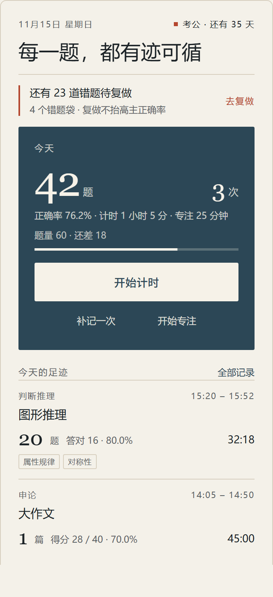
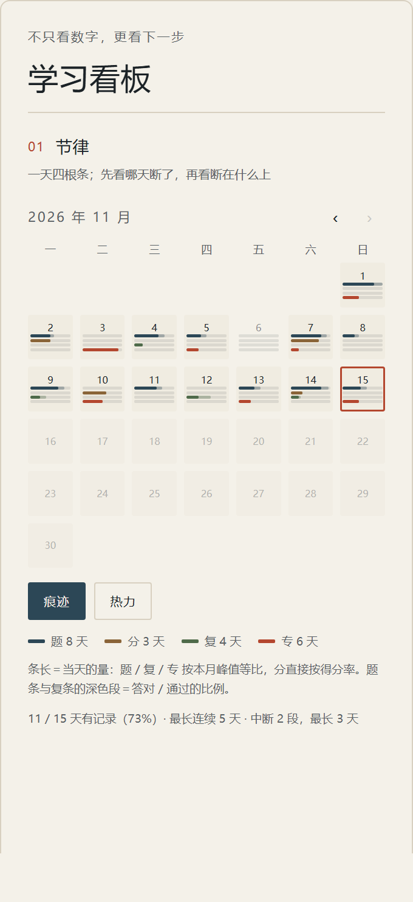
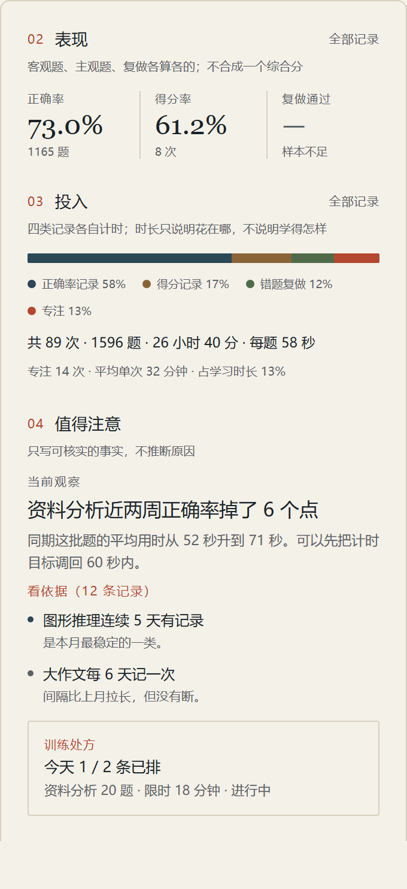
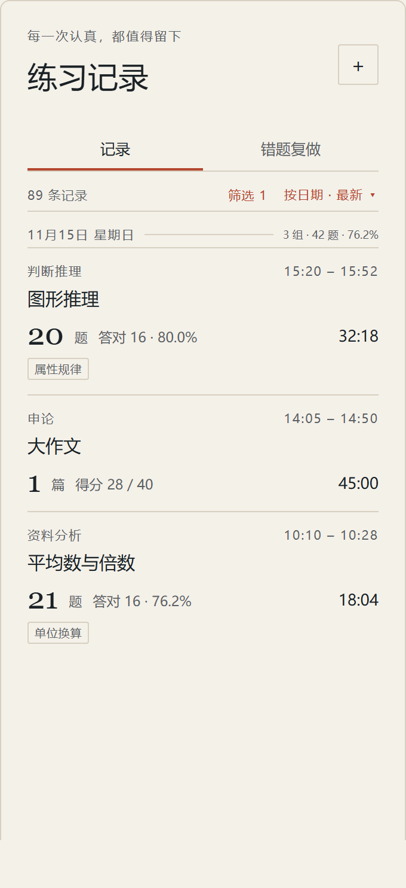
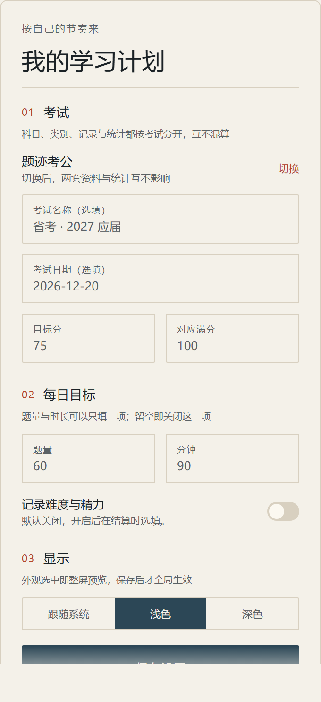

<div align="center">


<h1>题迹 · StudyClock</h1>

<p><b>离线优先的 Android 学习记录应用。只记事实，不合成分数；数据不出设备。</b></p>

<p>
  
  
  
  
  
</p>

</div>

---

## 界面

| | | |
|:--:|:--:|:--:|
| <br>**今日** | <br>**看板 · 上** | <br>**看板 · 下** |
| <br>**记录** | <br>**我的** | <sub>示意数据<br>与真机同尺寸 340 × 742 dp</sub> |

## 这是什么

给「每天做题」这件事做记录的工具。开一次计时、或者补记一次练习，它记下题量、正确数、时长、错在哪；然后按月历、按科目、按时段把这些痕迹摊开给你看。

它不 gamify、不排名、不推送、不联网。没有账号，没有云同步，没有广告位，也没有「今日学习力 87 分」这种说不清怎么算出来的数字。

主要面向题海型备考（公务员、事业单位、考研、语言类考试），但科目与类别可以自己改，用于别的场景也不别扭。

## 功能

| 模块 | 做了什么 |
|---|---|
| **记录四形态** | 客观题（题量 / 正确数）、计分题（得分 / 满分，0.1 分整数口径）、专注（只记时长，不进任何表现轨）、错题复做（第三形态之外的独立轨） |
| **计时** | 前台服务 + 通知栏直接暂停 / 继续 / 结束；到点结算；离开超过 4 小时要求人工确认；跨零点记录按「开始日 / 结束日」自选归属 |
| **错题闭环** | 按批次装错题袋，记复做轮次与通过情况；复做计入题量与时长，但不抬高主正确率 |
| **月历节律** | 一天四根条（题 / 分 / 复 / 专）同屏；条长是当天的量，深色段是答对 / 通过的部分；另有热力视图、覆盖率、最长连续、断档统计 |
| **看板五章** | 节律 / 表现 / 投入 / 值得注意 / 细节。观察、发现、训练处方、错题闭环都在第四章，回答「下一步做什么」 |
| **整理** | 科目与类别的改名、排序、归档、删除；预置的 43 条基线只可排序与归档，有任何记录引用的科目永不被删 |
| **数据出口** | CSV 20 列导出 / 导入（兼容旧 14 列）、JSON 全量备份与恢复（schema 6，可恢复 3–5）、可备份到自选的外部文件夹 |
| **小组件** | 桌面一键开始 25 分钟，计时中显示倒计时，暂停与结束不必先开应用 |

统计侧共 46 项指标，按 A–G、R、X、P 分组建档。

## 下载

**[⬇ 题迹 0.15.1（Debug 包，11.1 MiB）](release/tiji-0.15.1-debug.apk)**

- 要求 Android 8.0（API 26）及以上
- Debug 签名，可直接安装；首次安装需在系统里允许「安装未知来源应用」
- 覆盖安装不会丢数据，但**卸载会连同数据一起删除**——换机或重装前先在应用内做一次全量备份

校验：下载 [`release/SHA256SUMS.txt`](release/SHA256SUMS.txt)，在同一目录执行 `sha256sum -c SHA256SUMS.txt`。

## 从源码构建

需要 JDK 17 与 Android SDK Platform 34 / Build-Tools 34.0.0。Gradle 由 Wrapper 下载并校验官方 SHA-256；Kotlin、Compose、AGP 版本均已锁定。

```bash
# 1. 指向本机 SDK（二选一）
cp local.properties.template local.properties   # 然后填入 sdk.dir
export ANDROID_HOME=/path/to/Android/Sdk

# 2. 打包
./gradlew assembleDebug
# 产物：app/build/outputs/apk/debug/app-debug.apk
```

回归与质量闸：

```bash
./gradlew testDebugUnitTest        # 458 项 JVM 单测
./gradlew checkDesignContracts     # 指标登记表 / CSV 列数 / 领域层不得直接判断记录类型
./gradlew checkArchitecture        # 领域层不依赖 Android；UI 层不碰数据库类型
./gradlew connectedDebugAndroidTest  # 仪器测试，需要连接设备
```

Windows 上若用户名含非 ASCII 字符，`gradle.properties` 已把 Gradle 进程编码固定为 GBK（源码与产物仍是 UTF-8），细节见该文件注释。

## 数据与隐私

这件事值得单独说一段，因为它是本项目的第一设计约束。

- **没有 `INTERNET` 权限。** 这不是「默认关闭联网」或「不上传数据」的承诺，而是安装包里根本没有这个权限——应用在技术上无法发起任何网络请求。可以自己验证：

  ```bash
  $ANDROID_HOME/build-tools/34.0.0/aapt2 dump permissions app-debug.apk
  ```

  只会看到 `FOREGROUND_SERVICE`、`FOREGROUND_SERVICE_SPECIAL_USE`、`POST_NOTIFICATIONS`、`RECEIVE_BOOT_COMPLETED` 四项，全部服务于计时与提醒。

- **没有账号体系**，也没有统计、埋点、崩溃上报 SDK。
- **`android:allowBackup="false"`**：系统云备份不会把这个应用的数据带走，备份只发生在你自己点「备份全部数据」的时候。
- **数据存在应用私有目录**（Room 数据库 + DataStore），卸载即删除。
- **导出的文件由你自己保管**：CSV / JSON 写到你在系统文件选择器里指定的位置。**备份文件没有加密**，请自行加密或存到可信位置；应用内只自动保留 7 份。

## 设计取舍

这个项目里几个刻意的「不做」：

1. **三条表现轨不合并。** 正确率、得分率、复做通过率各算各的，不平均、不加权成一个综合分。它们的分母根本不是同一批题，合成出来的数字好看但没有含义。
2. **缺样本写「—」，不写 0%。** 「没有数据」和「数据是零」是两件事。
3. **复做不抬高主正确率。** 同一道题第二次做对，说明你后来会了，不说明第一次做对了。复做单独成轨。
4. **月历的条长只表示「那天做了多少」**，深浅才表示质量。看节奏就看长度，别把长度当水平。
5. **一句规则只说一次。** 口径说明集中收在页面末尾一处折叠里，不在每张卡片下面重复。

## 已知限制

- 仪器测试需要真机或模拟器；无设备时 `connectedDebugAndroidTest` 会跳过。
- 无障碍（TalkBack 逐项朗读、48 dp 触控尺寸实测）、万条记录下的长列表性能尚未系统验证。
- 深色主题下四个轨道色中的赭（`#C9A368`）与朱（`#B4472F`）在 2.5 dp 细条上偏近，图例可辨、细条靠色相区分。
- 仓库内 **不包含** 设计书、开发规划、决策记录与验收清单等内部文档，README 是唯一的对外说明。
- Release 签名密钥不在仓库内，`assembleRelease` 需要自备 `key.properties`；缺密钥时构建会直接失败，不会退回 debug 签名。

## 版本

| 版本 | 日期 | 要点 |
|---|---|---|
| 0.15.1 | 2026-11-15 | 真机走查修复八处：章号可读性、月历短条退化成点、口径标错、筛选面板按钮滚出屏幕、200% 字号溢出 |
| 0.15 | 2026-11-15 | 四页信息架构重构：看板 18 块 → 5 章；今日页合成一条接力；记录页筛选进面板 |
| 0.14 | 2026-11-15 | 月历改为「一天四根痕迹条」，四轨同屏 |
| 0.13 | 2026-11-15 | 月历置顶，四口径着色、连续与断档摘要 |
| 0.12 | 2026-11-15 | 分类管理：改名、排序、归档、删除 |

## 许可证

[MIT](LICENSE)。可以自由使用、修改、分发，保留版权声明即可。

「题迹」这一名称与应用图标不在授权范围内——fork 之后如果改了不少东西，请顺手换个名字和图标，避免两个不同的东西共用一个名字。
